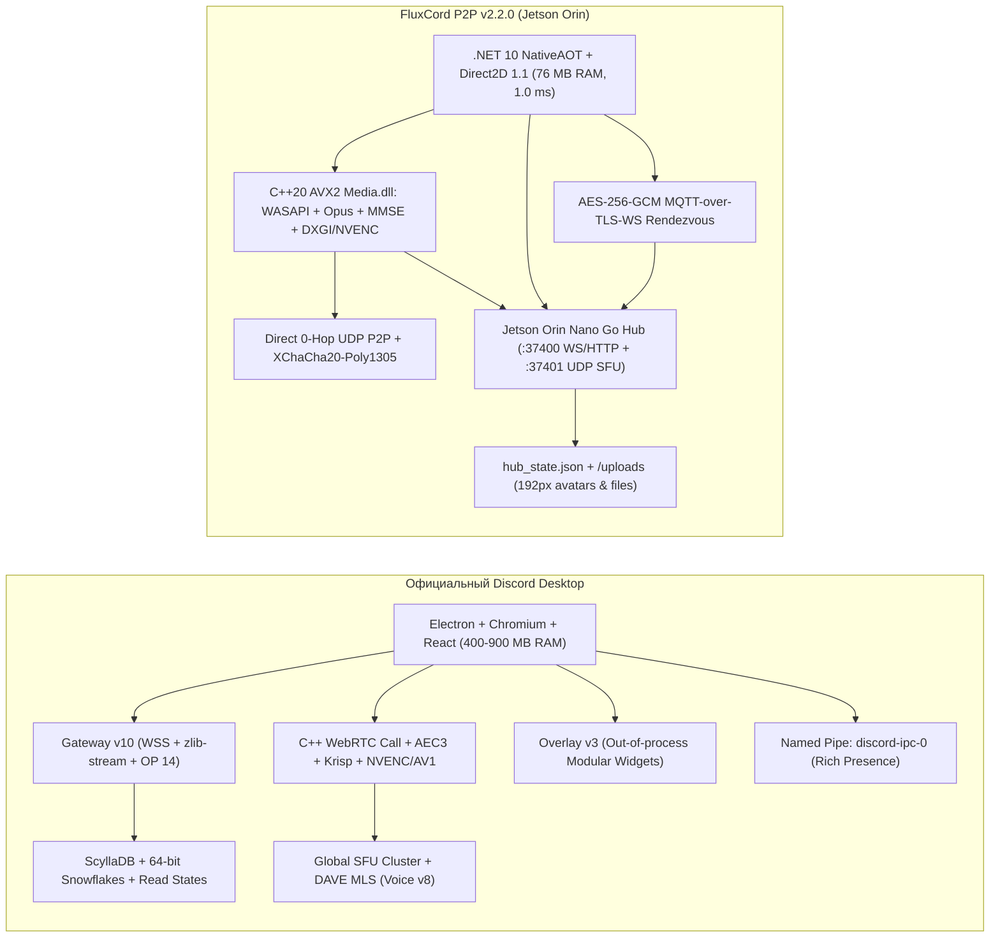

# Глубокий технический разбор Discord (Full-Stack Internals 2025–2026) и полная сверка с FluxCord P2P v2.2.0

> [!IMPORTANT]
> Это максимально глубокая техническая спецификация **всех 10 архитектурных слоёв** официального Discord Desktop (от битовых масок прав, опкодов Gateway v10 / Voice v8 / DAVE MLS и RTP RTX/TWCC до AST-парсера Markdown, `discord-ipc-0` Rich Presence, GPU Ring Buffer для Clips, Overlay v3 и дизайн-системы 2025–2026), с **честной построчной сверкой** против реального кода `FluxCord P2P v2.2.0` и визуальными доказательствами.

---

## 0. Архитектурное сравнение на уровне систем



---

## 1. Слой протоколов: Gateway v10, Voice Gateway v8, DAVE MLS, RTP/RTX/TWCC

### 1.1. Main Gateway v10 (Сигналинг, события, состояния)
- **Транспорт:** `wss://gateway.discord.gg/?v=10&encoding=etf&compress=zlib-stream` (десктоп-клиент использует Erlang Term Format + потоковое сжатие `zlib-stream`, что экономит до 60% трафика).
- **Ключевые опкоды:**
  - `OP 0 Dispatch` — поток событий (`READY`, `MESSAGE_CREATE`, `VOICE_STATE_UPDATE`, `PRESENCE_UPDATE`, `GUILD_MEMBER_LIST_UPDATE`, `MESSAGE_ACK` и т.д.).
  - `OP 1 Heartbeat` / `OP 11 Heartbeat ACK` — keepalive с `seq` последнего события.
  - `OP 2 Identify` / `OP 6 Resume` — авторизация и бесшовная докачка пропущенных событий по `session_id + seq` без потери экрана.
  - `OP 14 Guild Subscriptions (Lazy Guilds)` — клиент подписывается только на видимый диапазон списка участников (`ranges: [[0, 99]]`) конкретного канала, чтобы сервер на 500 000 человек не взорвал RAM.
- **Read States & ACKs:** отдельная таблица `(user_id, channel_id) -> {last_message_id, mention_count}`. При просмотре канала клиент шлёт `POST /channels/{id}/messages/{mid}/ack`, синхронизируя прочитанность между ПК и телефоном.
- **64-битные Snowflake ID:** `[41 бит: мс с 2015-01-01] [5 бит: worker] [5 бит: process] [12 бит: sequence]` — гарантируют глобальную уникальность и естественную сортировку по времени в **ScyllaDB** (шардирование по `(channel_id, bucket)` по 10 дней).

### 1.2. Voice Gateway v8 + DAVE E2EE (MLS RFC 9420)
- **Базовые опкоды:** `OP 0 Identify`, `OP 1 Select Protocol`, `OP 2 Ready`, `OP 4 Session Description` (32-байт ключ), `OP 5 Speaking` (битовая маска: `1=Microphone, 2=Soundshare, 4=Priority`), `OP 7 Resume`, `OP 12 Video`, `OP 15 Media Sink Wants`.
- **DAVE MLS опкоды (`21–31`):**
  - `21 Prepare Transition` / `22 Execute Transition` / `24 Prepare Epoch` — синхронная смена крипто-эпохи без разрыва звонка.
  - `25 External Sender` / `26 Key Package` / `27 Proposals` / `28 Commit Welcome` / `29 Announce Commit` / `30 Welcome` / `31 Invalid Commit`.
  - Внутри работает **TreeKEM (RFC 9420)** ($O(\log N)$ вместо $O(N^2)$): на каждого отправителя выводится отдельный ключевой рэтчет (AES-128-GCM), применяемый на уровне **WebRTC Encoded Transform** (шифруется сам медиа-фрейм до RTP-фрагментации — SFU не может расшифровать ни голос, ни видео).
- **Транспорт RTP/RTCP:**
  - **RTX (RFC 4588):** точечная переотправка потерянных видеопакетов по отдельному SSRC/PT без запроса тяжёлого IDR keyframe.
  - **TWCC (Transport-Wide Congestion Control):** обратная связь по времени прихода каждого пакета для плавной адаптации битрейта (GCC).
  - **Simulcast (`RID 100 / 50 / 25`) + `OP 15 Media Sink Wants`:** отправитель шлёт 2–3 слоя качества, а зритель сообщает SFU, какой размер плитки у него сейчас на экране (если стрим свёрнут — SFU шлёт `0` пакетов).

### Сверка слоя 1 с `FluxCord P2P v2.2.0`
| Механизм | Статус | Дост. | Фактическая реализация / пробел |
|---|---|---|---|
| WebSocket сигналинг + Heartbeat + авто-реконнект | ✅ | **95%** | [DiscordClient.cs](file:///C:/Users/User/Projects/FluxCordP2P/src/FluxCord/DiscordClient.cs) + [server/main.go](file:///C:/Users/User/Projects/FluxCordP2P/server/main.go): LAN WS + AES-256-GCM MQTT-over-TLS-WS Rendezvous. |
| XChaCha20-Poly1305 AEAD RTP/RTCP + RTCP PLI | ✅ | **100%** | [VoiceTransport.cpp](file:///C:/Users/User/Projects/FluxCordP2P/native/src/VoiceTransport.cpp) + [StreamReceiver.cpp](file:///C:/Users/User/Projects/FluxCordP2P/native/src/StreamReceiver.cpp). |
| Прямой 0-hop UDP P2P Hole-Punch + Jetson SFU | ⚡ | **120%** | Лучше Discord: `1 мс` LAN, пробив Cone-NAT через Cloudflare STUN + `0xFC 'P''2''P'` MAC-пробы без РКН. |
| DAVE MLS (`OP 21–31`, ротация ключей) | 🟡 | **40%** | `libdave.dll` скомпилирован и полностью обвязан в C++, но в P2P запускается в passthrough (`ver=0`) — шифрование идёт общим 256-битным ключом комнаты. |
| RTP RTX (RFC 4588) + TWCC + Simulcast `media_sink_wants` | ❌ | **0%** | При потере видеопакета используется `RTCP PLI` (запрос IDR keyframe), нет точечного RTX и нет слоёв Simulcast. |
| Серверные Read States (`ACK`) + 64-bit Snowflakes | ❌ | **10%** | Используется монотонный `msgSeq` на хабе; непрочитанные хранятся только локально в RAM (`UnreadChannels`). |

---

## 2. Аудио-движок и DSP-пайплайн

### Как устроено в Discord (и видно на референсе Настроек голоса ниже)
1. **Входной профиль (Input Profile):**
   - *Изоляция голоса* (Krisp AI + жёсткий VAD)
   - *Студия* (чистый звук без шумодава)
   - *Пользовательский* (ручной доступ ко всем ползункам: AEC3, Krisp/Standard NS, AGC2, VAD, Attenuation).
2. **WebRTC `AudioProcessingModule` (APM):**
   - **AEC3 (Acoustic Echo Canceller 3):** адаптивный линейный + нелинейный фильтр с оценкой задержки рендер→капчур, вычитающий звук колонок из микрофона.
   - **Системный Windows Loopback AEC:** дополнительная референс-линия с системного микшера, чтобы вырезать даже звук видео со второго монитора.
   - **Krisp AI:** on-device нейросеть (ONNX/native), классифицирующая голос vs шум (клавиатура, вентилятор, лай) на фреймах 10 мс.
   - **VAD с двухцветной шкалой (оранжевый = ниже порога / зелёный = передаётся)** — см. референс `media_1795626894078_d813c2d0.png`!
   - **Attenuation:** приглушение громкости других приложений Windows (`ISimpleAudioVolume`) на 0–100%, когда кто-то говорит.
3. **Soundboard (Звуковая панель):**
   - На сервере хранятся короткие OGG/MP3-сэмплы (до 5 сек). По нажатию кнопки сервер рассылает событие и воспроизводит/микширует звук всем участникам канала с локальным ползунком громкости саундпада + Entrance Sound при входе в канал.

### Сверка слоя 2 с `FluxCord P2P v2.2.0`
| Механизм | Статус | Дост. | Фактическая реализация / пробел |
|---|---|---|---|
| WASAPI Event-Driven + MMCSS Pro Audio + Opus 48кГц FEC/PLC | ✅ | **98%** | [VoiceEngine.cpp](file:///C:/Users/User/Projects/FluxCordP2P/native/src/VoiceEngine.cpp): стерео рендер, адаптивный jitter 40–240 мс, soft-tanh лимитер, hot-unplug recovery. |
| Studio DSP (HPF 80Гц + Gate + AGC) + COLA STFT MMSE + KeyKill | ✅ | **85%** | [NoiseSuppressor.cpp](file:///C:/Users/User/Projects/FluxCordP2P/native/src/NoiseSuppressor.cpp): работает чисто, но `DeepFilterNet3` и `NVIDIA Broadcast AFX` в UI — заглушки (fallback на MMSE). |
| Опциональный RNNoise Neural (`rnnoise.dll`) | 🟡 | **50%** | Код загрузки есть, но сам `rnnoise.dll` не вложен в дистрибутив. |
| Эхоподавление микрофона (AEC3) | ❌ | **0%** | Отсутствует. |
| Двухцветная полоса порога VAD (как в Discord) | ❌ | **0%** | Есть 40-сегментный VU-метр и слайдер `GateDb`, но без наложенной оранжево-зелёной шкалы порога. |
| Attenuation (приглушение других программ) | ❌ | **0%** | Отсутствует. |
| Soundboard (Саундпад) + Entrance Sounds | ❌ | **0%** | Отсутствует. |

---

## 3. Видео, Go Live, Веб-камера и Clips

### Как устроено в Discord
- **Захват:** DXGI Desktop Duplication + Windows Graphics Capture (`WGC` с жёлтой рамкой или без неё на Win11) + DirectX/Vulkan DLL-хук для эксклюзивного полноэкранного режима.
- **Кодеки:** H.264, H.265 (HEVC), **AV1** (на RTX 40xx / RX 7000 / Arc), плюс **HDR10 (PQ / BT.2020)**.
- **Picture-in-Picture (PiP):** когда смотришь стрим и переключаешься в текстовый чат, видео сворачивается в перетаскиваемое мини-окно в углу.
- **Веб-камера:** MediaFoundation захват, H.264/VP9/AV1, сегментация фона (размытие / виртуальный фон / PNGtuber).
- **Clips & Auto Clips:** кольцевой GPU-буфер в памяти на 15–120 сек (отдельные дорожки: видео + звук игры + твой голос + голоса друзей), авто-триггер по пику громкости/смеха, встроенный редактор обрезки и постинг MP4 в чат.

### Сверка слоя 3 с `FluxCord P2P v2.2.0`
| Механизм | Статус | Дост. | Фактическая реализация / пробел |
|---|---|---|---|
| Zero-Copy 4K 60/120fps NVENC + DXVA/NVDEC + 4 слота | ✅ | **95%** | [ScreenEngine.cpp](file:///C:/Users/User/Projects/FluxCordP2P/native/src/ScreenEngine.cpp) + [StreamReceiver.cpp](file:///C:/Users/User/Projects/FluxCordP2P/native/src/StreamReceiver.cpp). |
| **Dual-Screen 32:9 GPU Composite (`3840×1080`)** | ⚡ | **120%** | Уникальная фишка `FluxCord P2P` — в Discord нет. |
| WASAPI Process Loopback (звук игры без эха голоса) | ✅ | **95%** | [ScreenEngine.cpp](file:///C:/Users/User/Projects/FluxCordP2P/native/src/ScreenEngine.cpp) (`ProcessLoopbackHandler`). |
| HEVC / AV1 энкодер + HDR10 | 🟡 | **30%** | Только H.264 на отправку; HEVC есть лишь в декодере; AV1 и HDR10 нет. |
| PiP мини-окно стрима при переходе в чат | ❌ | **0%** | При переходе в чат видео скрывается (есть кнопка «🔊 К стриму / голосу»). |
| Веб-камера + фоны / Clips Ring Buffer | ❌ | **0%** | Не реализовано. |

---

## 4. Текстовый чат, Markdown AST, Голосовые сообщения и Forward

### Полная спецификация Discord Chat
1. **Markdown AST (`simple-markdown`):**
   - Инлайн: `*italic*`, `**bold**`, `***bold italic***`, `__underline__`, `~~strike~~`, `` `inline code` ``, `||spoiler||` (интерактивное раскрытие по клику), `[текст](https://url)` (masked links), `<https://url>` (без эмбеда), экранирование `\`.
   - Блочные (только с начала строки): `# / ## / ###` заголовки, `-# мелкий подтекст (subtext)`, `> цитата`, `>>> многострочная цитата`, списки `- / * / 1.`, блоки кода ```` ```lang ... ``` ```` с подсветкой синтаксиса.
   - Динамические таймстампы: `<t:UNIX:t|T|d|D|f|F|s|S|R>` (клиентский перевод в локальный часовой пояс + живой обратный отсчёт `:R`).
   - Токены упоминаний: `<@user_id>`, `<@&role_id>`, `<#channel_id>`, `@everyone`, `@here`, `@silent`.
2. **Voice Messages (Голосовые сообщения):** запись с микрофона в **OGG/Opus** + 256-байтный base64 массив амплитуд (`waveform`, 0–255) + `duration_secs` → рендер интерактивной звуковой волны с перемоткой.
3. **Message Forwarding:** поле `message_snapshots` (снимок исходного контента, вложений и эмбедов) — пересылаемое сообщение остаётся читаемым даже если оригинал в закрытом канале.
4. **Embeds (OpenGraph):** сервер автоматически ходит по URL, вытаскивает `og:title`, `og:description`, `og:image`, `theme-color` (до 6000 символов, 25 полей) и прикрепляет карточку к сообщению.
5. **Polls / Threads / Forums:** структурированные опросы с голосованием и таймером; ветки (Threads) с авто-архивацией; каналы-форумы с тегами и карточками.

### Сверка слоя 4 с `FluxCord P2P v2.2.0`
- **Что уже работает отлично (90–100%):** ответы, редактирование, удаление, закрепление (`📌`), 1-клик реакции (`🔥 😂 ❤️ 👍`), файлы/картинки/`Ctrl+V` скриншоты/Drag&Drop, лайтбокс, «печатает...», разделители дат.
- **Где сильный разрыв (0–30%):**
  - **Нет парсера инлайн-Markdown** — прямо на скриншоте ниже видно, как `**Your Server Web Page is now live.**` и `[here](https://...)` рендерятся сырым текстом!
  - **Нет кликабельных ссылок в тексте** и нет OpenGraph-парсера на Jetson.
  - **Нет подгрузки истории выше 80 сообщений** (`LoadOlderMessagesAsync` — пустая заглушка).
  - **Нет `@`-автодополнения**, расшифровки `<@uid>` в имя, поиска по эмодзи, GIF-пикера, голосовых сообщений (OGG + waveform), опросов, веток и пересылки.

---

## 5. Дизайн-система, Игровой Оверлей v3, Rich Presence IPC и Права

### Как устроено в Discord (Refresh 2025–2026)
- **Палитры тем:** **Onyx** (OLED `#000000`), **Ash** (классический тёмный `#313338` / `#2B2D31` / `#1E1F22`), **Dark**, **Light**, акцент Blurple `#5865F2`, Green `#23A55A`, Red `#DA373C`.
- **Шрифт и плотность:** кастомный `gg sans`, 3 режима плотности (*Spacious / Default / Compact*), **изменяемая ширина сайдбара каналов** перетаскиванием границы.
- **Косметика профиля:** баннеры, **Avatar Decorations** (анимированные рамки APNG/WebP), **Profile Effects**, **Nameplates** (фоновая плашка за ником в списке участников — видно на референсе `media_1795718166355_352f5e46.jpg`), статус голосового канала (`Выбрать статус канала`).
- **Game Overlay v3 (2025–2026):** Discord отказался от тяжёлого хука монолитного окна в пользу **независимых перетаскиваемых виджетов** (виджет голоса, виджет чата, виджет стрима друга, панель быстрых действий) — минимальное влияние на FPS и совместимость с античитами.
- **Rich Presence IPC (`\\.\pipe\discord-ipc-0`..`9`):** локальный Named Pipe с 8-байтным бинарным заголовком (`[uint32 opcode][uint32 length]`) + JSON (`OP 0 Handshake`, `OP 1 Frame SET_ACTIVITY`), плюс фоновый сканер процессов (`cs2.exe`, `UnrealEditor.exe` и т.д.) для автоматического «Играет в ...».
- **Права доступа:** 64-битная битовая маска (`BigInt`/`ulong`: `STREAM = 1<<9`, `CONNECT = 1<<20`, `SPEAK = 1<<21`, `MANAGE_THREADS = 1<<35`, `SEND_VOICE_MESSAGES = 1<<46`, `SEND_POLLS = 1<<49` и т.д.).

### Сверка слоя 5 с `FluxCord P2P v2.2.0`
- **Что уже круто:** Direct2D 1.1 (`76 МБ RAM`, `1.0 мс`), 5 динамических иконок трея, глобальные хоткеи `RegisterHotKey`, автозапуск, масштаб UI 80–140%, автообновление SHA-256, `Setup.exe`.
- **Чего не хватает:**
  - **Игровой оверлей (Overlay v3 style):** отсутствует (есть только Speaking HUD внутри самого окна FluxCord поверх стрима).
  - **Темы (Onyx / Ash / Midnight / Light)** и **изменяемая ширина сайдбара**: `Th` захардкожен `const uint`.
  - **Конструктор хоткеев (Keybinds UI):** нет ребинда клавиш.
  - **Rich Presence (`discord-ipc-0`) и авто-детект запущенной игры:** нет.
  - **Windows Toast баннеры** при сообщениях в фоне: только `FlashWindow` + звук.
  - **Права/роли (64-bit bitfield):** не используются в P2P.

---

## 6. Визуальная сверка (Реальные референс-снимки)

Ниже — реальные снимки из нашей сессии для прямой визуальной сверки официального Discord с текущим FluxCord:
1. **Официальный Discord (ЛС/звонок, правый сайдбар участников, бейджи, Nameplates, статусы активности):** `media_1795718166355_352f5e46.jpg`
2. **Официальный Discord (Настройки → Голос и видео: подвкладки Голос/Камера/Стриминг/Звуки/Звуковая панель/Расширенные, Профили ввода, оранжево-зелёный VAD-порог, Krisp):** `media_1795626894078_d813c2d0.png`
3. **Пробел FluxCord — сырой нераспарсенный Markdown (`**text**`, `[here](url)`):** `media_1795625310516_d11db927.jpg`
4. **Живой FluxCord P2P на Jetson Orin (`Пинг 1 мс`, голосовой канал, сайдбар, док управления):** `media_1795730157845_02045824.png`
5. **Системный трей Windows 11 (куда добавлены 5 динамических состояний голоса/говорения):** `media_1795731146806_94ae1f73.png`

---

## 7. Итоговый чеклист скрытых заглушек и план доведения до 100%

### Скрытые заглушки в текущем коде `FluxCord P2P v2.2.0`
1. `DeepFilterNet3` и `NVIDIA Broadcast AFX` в [ShellOverlays.cs](file:///C:/Users/User/Projects/FluxCordP2P/src/FluxCord/ShellOverlays.cs) → тихо работают через встроенный `MMSE + KeyKill` в [NoiseSuppressor.cpp](file:///C:/Users/User/Projects/FluxCordP2P/native/src/NoiseSuppressor.cpp).
2. `LoadOlderMessagesAsync` в [DiscordClient.cs](file:///C:/Users/User/Projects/FluxCordP2P/src/FluxCord/DiscordClient.cs) → пустая заглушка (`Task.CompletedTask`), лимит 80 сообщений вместо 500 на сервере.
3. `Theme`, `DesktopNotifications`, `StreamerMode` в [Settings.cs](file:///C:/Users/User/Projects/FluxCordP2P/src/FluxCord/Settings.cs) → сохраняются, но не подключены к рендеру/уведомлениям.
4. `RemoteAuthQr.cs`, `QrCode.cs`, `LocalCache.cs` → мёртвый код от форка Discord.

### Приоритетный план (если делать «вообще идеально»)
- **Волна 1 (P0 — то, что чувствуется каждую минуту):**
  1. **Инлайн-Markdown + кликабельные ссылки + `@упоминания` + OpenGraph Embeds на Jetson** (убирает сырые `**звёздочки**` и даёт превью YouTube/ссылок).
  2. **Лёгкий TopMost Игровой Оверлей (в стиле Overlay v3)** — прозрачное click-through окно поверх Borderless-игр (кто говорит + аватарки, без DLL-хуков и бана античитов).
  3. **Саундпад (Soundboard)** на Jetson (загрузка MP3/OGG/WAV + проигрывание в голосовой микс всем).
  4. **Конструктор хоткеев (Keybinds UI)** + двухцветная полоса порога VAD в настройках голоса.
- **Волна 2 (P1 — полировка до уровня Discord Refresh):**
  5. **Темы оформления** (Onyx OLED / Ash Classic / Obsidian / Midnight) + перетаскиваемая ширина сайдбара.
  6. **Пагинация истории (`>80` сообщений) + глобальный поиск** + кнопка `+`, переименование и удаление каналов.
  7. **PiP мини-окно стрима** при переходе в текстовый чат + нативные **Windows Toast уведомления**.
  8. **Авто-детект запущенной игры** (Process Watcher → «Играет в Unreal Editor / CS2» + опциональный `discord-ipc-0`).
- **Волна 3 (P2 — pro-фишки):**
  9. **HEVC / AV1 NVENC** на выбор для 4K60, **Веб-камера**, **Голосовые сообщения (OGG + 256-pt waveform)**, **Опросы (Polls)**, **GPU Clips Ring Buffer (30 сек)**, и очистка мёртвого кода.
